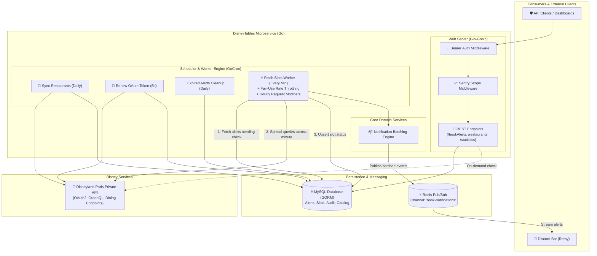

<div align="center">

# 🍽️ DisneyTables

**High-performance Disneyland Paris dining reservation availability tracker & event dispatcher in Go.**

[](https://go.dev/)
[](https://gin-gonic.com/)
[](https://gorm.io/)
[](https://redis.io/)
[](https://www.docker.com/)
[](https://sentry.io/)
[](LICENSE)

<p align="center">
  <a href="#-project-overview">Overview</a> •
  <a href="#-architecture">Architecture</a> •
  <a href="#-key-features">Key Features</a> •
  <a href="#-repository-structure">Structure</a> •
  <a href="#-api-reference">API Reference</a> •
  <a href="#-getting-started">Getting Started</a>
</p>

</div>

---

## 📖 Project Overview

Securing table reservations at Disneyland Paris table-service restaurants (such as *Bistrot Chez Rémy*, *Captain Jack's*, or *Auberge de Cendrillon*) is notoriously competitive, with slots often booking out months in advance or opening unpredictably due to last-minute cancellations.

**DisneyTables** solves this problem by providing a resilient, automated microservice that tracks table availabilities across park and hotel restaurants. Rather than overwhelming Disney's upstream systems, it executes intelligent, fair-use background polling, tracks inventory state in MySQL via GORM, batches newly opened time slots, and streams real-time events over **Redis Pub/Sub**.

Consumer clients—such as [**Remy**](https://github.com/Romitou/Remy), a dedicated Discord bot—subscribe to these events to instantly alert guests when their requested dining slots become available.

---

## 🏛️ Architecture

DisneyTables is designed around clean separation of concerns, concurrency safety, and observable background automation:



### Stack Choices & Justifications

* **Go (Golang)**: Chosen for high execution speed, minimal runtime memory footprint (<30 MB RAM), and native concurrency primitives (`goroutines`, `time.AfterFunc`) ideal for scheduler-based workers.
* **Gin-Gonic**: Ultra-lightweight HTTP web framework with robust middleware chaining for authentication and observability.
* **GORM**: Ergonomic ORM providing schema auto-migrations, relationship preloading (`Preload`), and safe query building.
* **Redis Pub/Sub**: Decouples the availability detection worker from external alert delivery (Discord bots, WebSockets, or push notifications).
* **Sentry**: End-to-end exception capturing with enriched transaction metadata (date, party size, restaurant ID, and raw upstream payloads for debugging API regressions).

---

## ✨ Key Features

* **🛡️ Polite & Adaptive Rate Limiting**: Avoids aggressive scraping. Checks are evenly spaced out over time using `time.AfterFunc` to distribute traffic smoothly.
* **🌙 Hourly Request Modifiers (Eco Mode)**: Dynamically adjusts request limits throughout the 24h cycle (e.g., lower frequency at night, heightened frequency around opening times) through the `REQUEST_MODIFIERS` environment variable.
* **📦 Notification Deduplication & Batching**: Groups multiple simultaneously discovered meal slots (e.g. 18:30, 19:00, 19:30) for the same user alert into a single consolidated notification payload.
* **🔄 Automatic OAuth Token Rotation**: Disney upstream session tokens are refreshed automatically every 6 hours and stored in the database.
* **📊 Metrics & Daily Reporting**: Provides dedicated endpoints (`/statistics` and `/dailyReport`) tracking check intervals, alert volumes, and notification history.
* **🐳 Production-Ready Containerization**: Multi-stage Docker build producing a minimal Alpine binary with native timezone data (`tzdata`).

---

## 📁 Repository Structure

```
.
├── api/                       # Disneyland Paris API client (HTTP requests, GraphQL, auth)
│   └── main.go
├── core/                      # Core business logic & notification batching
│   ├── notifications.go
│   └── notifications_test.go  # Unit tests for notification grouping
├── database/                  # GORM database connection & repositories
│   ├── main.go
│   └── models/                # GORM database entity models
│       ├── authDetails.go     # Disney OAuth token records
│       ├── bookAlert.go       # User dining alert criteria
│       ├── bookNotification.go# Historical notification logs
│       ├── bookSlot.go        # Restaurant availability slots
│       └── restaurant.go      # Restaurant catalog entity
├── redis/                     # Redis client & Pub/Sub message publishing
│   └── main.go
├── tasker/                    # Scheduled background jobs engine
│   ├── main.go
│   └── tasks/
│       ├── cleanupOldBookAlerts.go # Daily purge of expired alerts
│       ├── fetchRestaurantSlots.go # Main polling worker & rate limiting
│       ├── renewAuthDetails.go     # Disney token rotation worker
│       └── syncRestaurants.go      # Restaurant catalog sync worker
├── webserver/                 # Gin HTTP server & routing
│   ├── main.go
│   └── middlewares/           # HTTP middlewares
│       ├── auth.go            # Bearer token validation
│       ├── auth_test.go       # Auth unit tests
│       └── sentry.go          # Sentry tracing middleware
├── .github/workflows/         # CI/CD pipelines (Docker image build & push)
├── Dockerfile                 # Multi-stage container definition
├── Makefile                   # Developer productivity commands
├── go.mod                     # Go module definitions
├── go.sum                     # Checksums for dependencies
├── .env.example               # Configuration template
└── README.md
```

---

## 📡 API Reference

All endpoints (except health probes) require authentication via Bearer token:
```http
Authorization: Bearer <WEBSERVER_TOKEN>
```

### Endpoints Overview

| Method | Endpoint | Description |
|--------|----------|-------------|
| `GET` | `/restaurants` | List all synced Disneyland Paris restaurants |
| `POST` | `/restaurantAvailabilities` | Real-time live check of dining availabilities for a specific date and party size |
| `GET` | `/bookAlerts` | List all currently active user book alerts |
| `POST` | `/bookAlerts` | Register a new user book alert |
| `POST` | `/completeBookAlert` | Mark an alert as completed/resolved |
| `GET` | `/statistics` | Return aggregate counts of active alerts and future slots |
| `GET` | `/dailyReport` | Return 24-hour summary of alerts, discovered slots, and check intervals |

#### Example: Register a Book Alert (`POST /bookAlerts`)

**Request:**
```json
{
  "discordId": "123456789012345678",
  "restaurantDisneyId": "P1NA100_bistrot-chez-remy",
  "date": "2024-06-15",
  "mealPeriod": "Dinner",
  "partyMix": 4
}
```

**Response (200 OK):**
```json
{
  "id": 42,
  "restaurant": {
    "id": 5,
    "disneyId": "P1NA100_bistrot-chez-remy",
    "name": "Bistrot Chez Rémy",
    "imageUrl": "https://media.disneylandparis.com/...",
    "displayed": true
  },
  "restaurantId": 5,
  "discordId": "123456789012345678",
  "date": "2024-06-15",
  "mealPeriod": "Dinner",
  "partyMix": 4,
  "completed": false,
  "lastChecked": "0001-01-01T00:00:00Z",
  "checkCount": 0,
  "errorCount": 0,
  "createdAt": "2024-04-10T12:00:00Z",
  "updatedAt": "2024-04-10T12:00:00Z"
}
```

---

## 🚀 Getting Started

### Prerequisites

* **Go 1.19+**
* **MySQL 8.0+** (or MariaDB)
* **Redis 6.0+**

### Local Setup

1. **Clone the repository:**
   ```bash
   git clone https://github.com/romitou/disneytables.git
   cd disneytables
   ```

2. **Configure environment:**
   ```bash
   cp .env.example .env
   # Edit .env with your credentials (database, Redis, Disney endpoints)
   ```

3. **Install dependencies & run tests:**
   ```bash
   make vet
   make test
   ```

4. **Build and run locally:**
   ```bash
   make run
   # Or build binary:
   make build
   ./builds/disneytables
   ```

### Docker Deployment

Build and run using the included multi-stage Dockerfile:

```bash
# Build Docker image
docker build -t disneytables:latest .

# Run container with environment file
docker run -d \
  --name disneytables \
  --restart unless-stopped \
  --env-file .env \
  -p 8080:8080 \
  disneytables:latest
```

---

## 🧪 Testing & Code Quality

Run the test suite with Go's race detector:

```bash
make test
```

Inspect code quality and static analysis:

```bash
make vet
```

---

## 📄 License

This project is open-source and distributed under the terms of the [MIT License](LICENSE).
See the `LICENSE` file for details.
